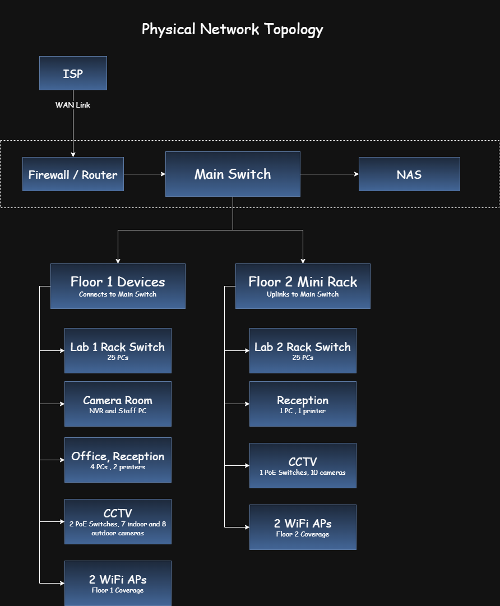

# Network Topology

## Physical Network Topology

The physical diagram will show equipment locations and actual connections, starting with the Etisalat connection and main rack. It should include the firewall/router, switches, floor mini racks, lab switches, CCTV PoE switches, access points, NVR, NAS, and end devices.

The diagram should make the physical uplinks and equipment locations clear.

## Logical Network Topology

The logical topology describes how network devices communicate and how traffic is distributed between network segments. The design uses core, distribution, and access functions.

### Functional Layers

- **Core layer:** `SW-CORE` provides the central switching point between the firewall and the distribution network.
- **Distribution layer:** `SW-MAIN-GF` and `SW-MAIN-L2` aggregate connections for their respective floors and connect access networks to the core.
- **Access layer:** Lab switches, CCTV PoE switches, and other access switches connect end devices.

These are functional roles and do not require a separate physical device for every layer.

### Proposed Network Structure

`Internet → FW-CORE → SW-CORE → SW-MAIN-GF / SW-MAIN-L2 → Access Switches → End Devices`

- `FW-CORE` provides the internet gateway, inter-VLAN routing, and network access control.
- `SW-CORE` is the core switch in the ground-floor main rack.
- `SW-MAIN-GF` is the ground-floor distribution switch in the main rack room.
- `SW-MAIN-L2` is the second-floor distribution switch in the second-floor mini rack.
- Both distribution switches connect directly to `SW-CORE`.
- The ground-floor distribution switch serves ground-floor access networks; `SW-MAIN-L2` serves second-floor access networks.
- Unmanaged lab switches connect lab computers within their assigned Students VLAN. VLAN assignment and traffic control are handled by the managed network infrastructure upstream.

VLANs separate devices into logical broadcast domains. Trunk links carry multiple VLANs between compatible managed devices, while access ports assign connected devices to their designated VLAN.

The third floor is excluded from the initial implementation but may be incorporated during future expansion.

---

**Navigation:** [← Building and Cabling](02-building-and-cabling.md) | [Next: VLAN and IP Plan →](04-vlan-and-ip-plan.md)